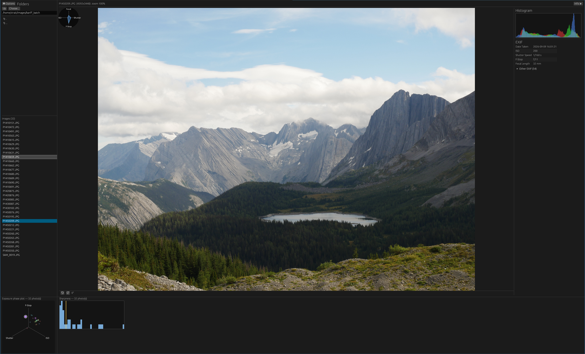

# geeq

A minimal, fast, geeqie-style image viewer written in Rust with [egui](https://github.com/emilk/egui)/[eframe](https://github.com/emilk/egui).



## Commands

Install, then add `cgeeq` and `pgeeq` as links to the same binary (once;
they keep working across reinstalls):

```sh
cargo install --path .
ln -sf geeq ~/.cargo/bin/cgeeq
ln -sf geeq ~/.cargo/bin/pgeeq
```

Run:

```sh
geeq [file-or-folder]    # compact UI with the Files panel open
cgeeq [file-or-folder]   # compact UI, just the picture
pgeeq [file-or-folder]   # photography: full UI with EXIF/histogram and folder plots
```

The compact UI is a full-window picture with everything else in the
right-click radial menu. Press and hold the right button, move toward an
item, and let go to pick it; a quick right-click leaves the menu open for
clicking. `C`, Options or Full in the radial menu switches to the full UI
(folder list, EXIF/histogram panel, rotate bar) and back.

Video mode: add `--video` (or `-V`) to either command.

## Features

- **Folder navigator + file list** on the left, open at start in `geeq` and `pgeeq`, toggled with Files in the radial menu (`.`/`..` entries, hidden-file toggle, recently-active directories weighted by usage)
- **Opens on the top photo**: launching geeq or entering a folder opens the folder's first image (or the file you passed on the command line)
- **Thumbnail grid**: `G` (or Options → Thumbnail grid) swaps the image view for a grid of the whole folder. Arrow keys move between cells, `Enter` or a click opens the photo, and right-click adds it to the clip stack. Turn on Options → *Start in thumbnail grid* to open geeq in the grid every time (saved to `~/.config/geeq/start_in_grid.txt`)
- **Fast keyboard browsing**: `↑`/`↓` or `[`/`]` step through images, with fast auto-repeat while held
- **Image view** that fits the available space, with GPU-cheap zoom (scroll wheel or `+`/`-`, centered on the viewport) and drag-to-pan
- **Display-only rotation** via Rotate in the radial menu (90° per pick), or the left/right/reset bar in the full UI (doesn't touch the file on disk)
- **EXIF**: key fields (date, ISO, shutter speed, f-stop, focal length) shown up front, everything else in a collapsible section
- **RGB histogram** and a small radial HUD overlay of the current shot's exposure settings
- **Directory-wide analytics**: a 3-axis exposure phase plot (f-stop / ISO / shutter speed) and a sharpness (Laplacian variance) histogram across every image in the folder, both scanned in the background
- **Clip stack**: right-click a file (or press `\` on the open image) to add/remove it from a running stack; the stack is copied to the clipboard as shell-quoted paths for pasting into a terminal (`cp`/`mv`/etc.), with a thumbnail popup showing what's queued
- **Live filters**: load the looks exported from [snaplite](../snaplite) (Looks → Export looks → `snaplite-looks.json`) via Options → Live filters → Load looks. With filter mode on (`F`), toggle looks with the number keys `1`–`9` or the list; they stack in the order switched on and are applied on the fly to every image as you browse. Display-only, like rotation: files on disk are never touched. The pixel pipeline is a Rust port of snaplite's engine; geometry (crop/rotate) isn't part of a look.
- **Slideshow / screensaver**: `S` (or Options → Slideshow) goes fullscreen and cycles the folder every 3–30 s (default 7, optional shuffle) with the currently selected live filters applied. `Esc`, `S` or a click exits; arrow keys still step manually
- **Animated GIFs and WebPs** play in the viewer, showing the first frame while the rest decode (Pause in the radial menu, frame counter in the caption); live filters apply to every frame
- **Camera raw / DNG**: `.dng`, `.raw`, `.rw2`, `.cr2`/`.cr3`, `.nef`, `.arw`, `.raf`, `.orf`, `.pef` and more open like any other photo (via [rawler](https://crates.io/crates/rawler)). Uses the embedded full-size preview when the file has one, otherwise develops the raw data. Display only; the files are never touched
- **PDF preview**: `.pdf` files list like photos and open as pages 1 and 2 side by side (one page for a one-page PDF), rendered at screen size by poppler's `pdftoppm`, both pages at once. Grid thumbnails render at thumbnail size
- JPEG decoding via libjpeg-turbo (`turbojpeg`); everything else via the `image` crate

## Running

```sh
cargo run --release
```

## Building

Requires a system install of `libjpeg-turbo` (for the `turbojpeg` crate). PDF preview needs poppler's `pdftoppm` on `PATH`.
