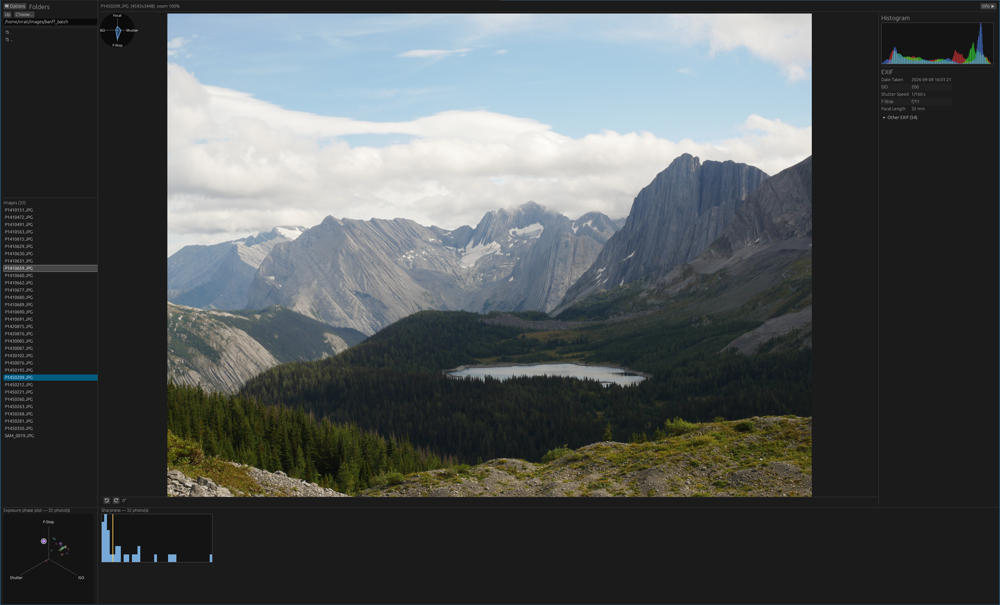

# geeq

A minimal, fast, geeqie-style image viewer written in Rust with [egui](https://github.com/emilk/egui)/[eframe](https://github.com/emilk/egui).



## Features

- **Folder navigator + file list** on the left (`.`/`..` entries, hidden-file toggle, recently-active directories weighted by usage)
- **Fast keyboard browsing**: `↑`/`↓` or `[`/`]` step through images, with fast auto-repeat while held
- **Image view** that fits the available space, with GPU-cheap zoom (scroll wheel or `+`/`-`, centered on the viewport) and drag-to-pan
- **Display-only rotation** via a bottom bar under the image (doesn't touch the file on disk)
- **EXIF**: key fields (date, ISO, shutter speed, f-stop, focal length) shown up front, everything else in a collapsible section
- **RGB histogram** and a small radial HUD overlay of the current shot's exposure settings
- **Directory-wide analytics**: a 3-axis exposure phase plot (f-stop / ISO / shutter speed) and a sharpness (Laplacian variance) histogram across every image in the folder, both scanned in the background
- **Clip stack**: right-click a file (or press `\` on the open image) to add/remove it from a running stack; the stack is copied to the clipboard as shell-quoted paths for pasting into a terminal (`cp`/`mv`/etc.), with a thumbnail popup showing what's queued
- JPEG decoding via libjpeg-turbo (`turbojpeg`); everything else via the `image` crate

## Running

```sh
cargo run --release
```

## Building

Requires a system install of `libjpeg-turbo` (for the `turbojpeg` crate).
